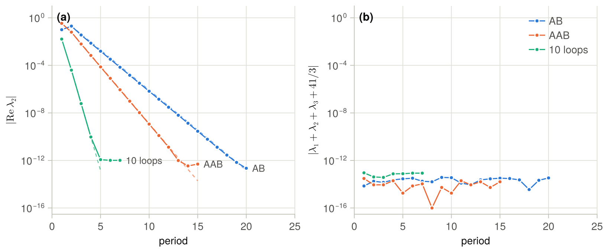
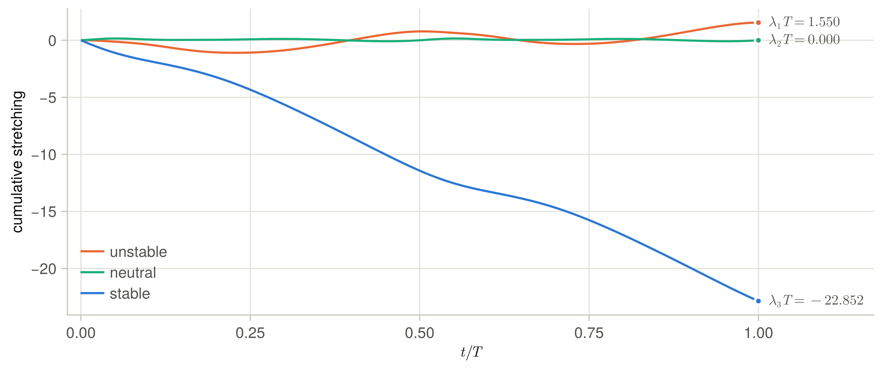
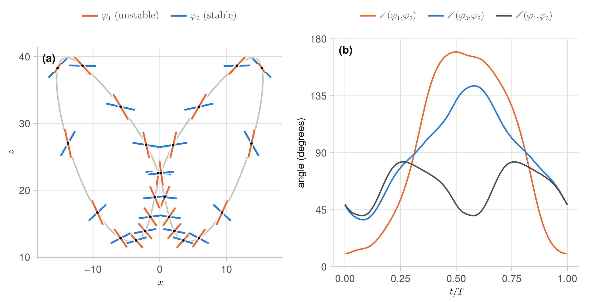
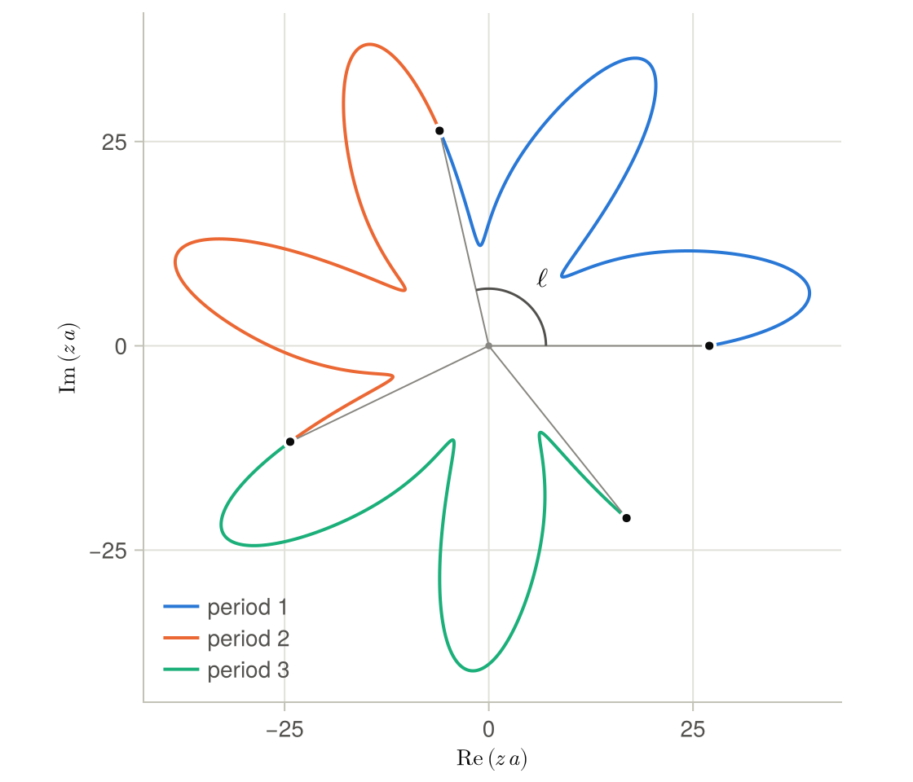

<p align="center">
  
</p>

# Floquet.jl

Floquet.jl computes the Floquet exponents of periodic and relative periodic orbits of dynamical
systems, together with their Floquet vectors and the corresponding adjoint vectors. It implements a
matrix-free version of the periodic eigendecomposition of Ding and Cvitanović (2016), discussed in
appendix A of Lasagna (2020), in which the orbit and the linearised equations are integrated with
[Flows.jl](https://github.com/Davide-Lasagna-s-Lab/Flows.jl). The method needs only the action of
the linearised equations on tangent vectors, and that of the adjoint equations for the vectors. The
package is therefore suited to the large systems that arise from the discretisation of partial
differential equations, for which the monodromy matrix cannot be formed.

The package is designed for long and strongly unstable orbits. Over one period of such an orbit the
Floquet multipliers span more orders of magnitude than double precision can resolve, and the
eigenvalues of the monodromy matrix, or of its action in a Krylov method, return the contracting
multipliers with large errors. Floquet.jl never forms the product of the propagators of the segments
of the orbit, and computes every exponent with the accuracy of the time integration, however far it
lies from the leading one.


## Floquet theory

In this section we recall the definitions used throughout, following Lasagna (2020). We consider
dynamical systems of the form

```math
\dot u = f(u), \qquad u \in X,
```

where the state space $X$ is a real vector space with inner product $\langle \cdot, \cdot \rangle$,
the function `dot` in the code. Let $u(t) = u(t + T)$ be a periodic orbit of period $T$. Small
perturbations $y$ of the orbit obey the linearised equations

```math
\dot y = J(t)\, y, \qquad J(t) = \mathrm{D}f(u(t)),
```

whose solutions are $y(t) = Y(t, s)\, y(s)$, with $Y(t, s)$ the propagator from time $s$ to time
$t$. The propagator over one period, $M = Y(T, 0)$, is the monodromy matrix. Its eigenvalues are the
Floquet multipliers $\Lambda_j$, and the Floquet exponents $\lambda_j$ are their logarithms divided
by the period,

```math
M \varphi_j(0) = \Lambda_j\, \varphi_j(0), \qquad \lambda_j = \frac{\log \Lambda_j}{T},
```

with imaginary parts in $(-\pi/T, \pi/T]$. The real part of $\lambda_j$ is the mean rate at which
perturbations along $\varphi_j$ grow or decay along the orbit. A negative multiplier has an exponent
with imaginary part $\pi/T$, and its eigenvector flips at every period. A complex-conjugate pair of
multipliers defines a real invariant plane, in which perturbations rotate as they grow or decay.

The eigenvectors are carried along the orbit by the linearised equations. The Floquet vectors
$\varphi_j(t) \propto Y(t, 0)\, \varphi_j(0)$ are covariant, in the sense that
$Y(t, s)\, \varphi_j(s) \propto \varphi_j(t)$, and Floquet's theorem states that
$Y(t, 0)\, \varphi_j(0) = e^{\lambda_j t} p_j(t)$, with $p_j$ periodic of period $T$. The direction
of the flow is one of the Floquet vectors, since $Y(t, s)\, f(u(s)) = f(u(t))$, with unit multiplier
and zero exponent.

The adjoint equations

```math
-\dot w = J(t)^{\top} w,
```

in which $\top$ denotes the adjoint in $\langle \cdot, \cdot \rangle$, conserve the inner product
$\langle w(t), y(t) \rangle$ with any solution of the linearised equations. Their solutions march
backwards in time, $w(s) = Y(t, s)^{\top} w(t)$, and the adjoint Floquet vectors satisfy
$M^{\top} \psi_j(0) = \Lambda_j\, \psi_j(0)$. Once normalised, the two families of vectors are
biorthogonal at every time,

```math
\langle \psi_i(t), \varphi_j(t) \rangle = \delta_{ij} .
```

A perturbation of the orbit can then be decomposed as

```math
y(t) = \sum_j \langle \psi_j(t), y(t) \rangle\, \varphi_j(t),
```

where the coefficient $\langle \psi_j, y \rangle$ measures the component of the perturbation along
$\varphi_j$, which grows by the factor $\Lambda_j$ over each period. This decomposition separates,
for instance, the deviation of a nearby trajectory from the orbit into its unstable, neutral and
stable parts.

### Relative periodic orbits

Systems with a continuous symmetry, such as the translations of a periodic domain, have relative
periodic orbits (Cvitanović et al., ChaosBook). Let $\sigma_\ell$ be a group of orthogonal operators
acting on $X$, under which the flow is equivariant, $f(\sigma_\ell u) = \sigma_\ell f(u)$. A relative
periodic orbit returns after one period to a shifted copy of its initial state,
$u(T) = \sigma_\ell\, u(0)$. Its multipliers are the eigenvalues of the comoving monodromy matrix,
and its adjoint vectors are the eigenvectors of the adjoint of this matrix,

```math
\tilde M = \sigma_{-\ell}\, Y(T, 0), \qquad \tilde M^{\top} = Y(T, 0)^{\top}\, \sigma_{\ell},
```

where we used $\sigma_{-\ell}^{\top} = \sigma_{\ell}$, which holds for orthogonal operators. A relative
periodic orbit has two unit multipliers, along the direction of the flow and along the group tangent
$g(u) = \partial_\ell\, \sigma_\ell u \,|_{\ell = 0}$, which span a neutral plane. In Floquet.jl the
keyword `shift` applies $\sigma_{-\ell}$ to the tangent vectors at the end of each period, and the
keyword `shiftadj` applies $\sigma_\ell$ to the adjoint vectors. An orbit that closes up to a
discrete symmetry, such as a reflection, is treated in the same way, with `shiftadj = shift`.


## Comparison with the eigenvalues of the monodromy matrix

The usual approach computes the multipliers as the eigenvalues of $M$. For a small system, $M$ is
formed by integrating the linearised equations from the identity over one period. For a large
system, the Arnoldi iteration is applied to the action $y \mapsto My$, at the cost of one
integration of the linearised equations per iteration. Both approaches give accurate leading
multipliers, but they lose the contracting multipliers of long and strongly unstable orbits.

The reason is the spread of the multipliers. A backward-stable eigenvalue solver returns the exact
eigenvalues of a matrix within about $\varepsilon \Vert M \Vert$ of $M$, where
$\varepsilon \approx 10^{-16}$ is the machine precision and $\Vert M \Vert$ is of the order of the
leading multiplier. The $k$-th multiplier then carries a relative error of about

```math
\varepsilon\, \frac{|\Lambda_1|}{|\Lambda_k|} = \varepsilon\, e^{\mathrm{Re}(\lambda_1 - \lambda_k)\, T},
```

which grows exponentially with the period of the orbit. The Arnoldi iteration has the same limit.
Each Krylov vector is the image under $M$ of the previous one, so that its components along the
contracting directions fall below the rounding error of the leading one.

The Lorenz equations give a check of accuracy. Their divergence is constant, equal to $-41/3$ for
the standard parameters, so that every periodic orbit satisfies
$\lambda_1 + \lambda_2 + \lambda_3 = -41/3$, with $\lambda_2 = 0$. Table 1 compares the stable
exponent $\lambda_3$ computed by `floquet` with the one obtained from the eigenvalues of $M$, on
three orbits converged by Newton shooting, AB and AAB in the notation of Viswanath (2003) and an
orbit with ten loops around the two wings of the attractor. Both
computations use the eighth-order scheme RK8, with 4000 steps per period for AB and AAB and 20000
for the orbit with ten loops, so that the error of the integration is negligible. The matrix $M$ is
formed from the identity, which is what the Arnoldi iteration would converge to in three
dimensions. The errors are those of the sum rule, $|\lambda_1 + \lambda_2 + \lambda_3 + 41/3|$, and
the column with RK4 gives for reference the error of `floquet` with a fourth-order integration of
the linearised equations.

*Table 1. Stable exponent and error of the sum rule on three periodic orbits of the Lorenz equations.*

| Orbit    | Period $T$ | $\Lambda_3$          | $\lambda_3$, `floquet` | $\lambda_3$, eigenvalues of $M$ | Error, `floquet` with RK4 | Error, `floquet` with RK8 | Error, eigenvalues of $M$ |
|----------|------------|----------------------|------------------------|---------------------------------|---------------------------|---------------------------|---------------------------|
| AB       | 1.559      | $1.2\times 10^{-10}$ | −14.661317             | −14.661312                      | $2.4\times 10^{-10}$      | $3.4\times 10^{-14}$      | $4.5\times 10^{-6}$       |
| AAB      | 2.306      | $2.2\times 10^{-15}$ | −14.627436             | −14.091510                      | $1.1\times 10^{-9}$       | $1.6\times 10^{-14}$      | 0.54                      |
| 10 loops | 7.416      | $1.5\times 10^{-47}$ | −14.539990             | −4.036058                       | $1.8\times 10^{-10}$      | $8.5\times 10^{-14}$      | 11                        |

The errors of the eigenvalues of $M$ follow the estimate above. On the orbit AB the ratio
$|\Lambda_1/\Lambda_3|$ is about $4\times 10^{10}$, and $\lambda_3$ is accurate to six digits. On
the orbit AAB the ratio is about $4\times 10^{15}$, close to the inverse of the machine precision,
and $\lambda_3$ is off by about one half. On the orbit with ten loops the stable multiplier is about
$10^{-47}$, the eigenvalues of $M$ return a value set by rounding, and the stable exponent is off by
more than ten. On all three orbits `floquet` satisfies the sum rule to the rounding error with RK8,
and to the error of the scheme with RK4, while the leading exponents of the two methods agree to
about twelve digits.


## The periodic Schur decomposition

The periodic Schur decomposition avoids these errors, because it never forms the product of the
propagators (Bojanczyk, Golub and Van Dooren 1992, Lust 2001). Take times
$0 = t_0 < t_1 < \dots < t_K = T$ along the period, and let $Y_k = Y(t_k, t_{k-1})$ be the
propagator over the $k$-th segment, so that $M = Y_K \cdots Y_1$. The decomposition writes each
propagator in terms of orthogonal matrices $Q_k$ and triangular factors $R_k$,

```math
Y_k\, Q_{k-1} = Q_k\, R_k, \qquad k = 1, \dots, K,
```

with $Q_K = Q_0$ for a periodic orbit and $Q_K = \sigma_\ell Q_0$ for a relative periodic orbit. The
product of the factors is then the monodromy matrix in the basis $Q_0$, and the multipliers follow
from the diagonal entries of the factors,

```math
Q_0^{\top} \tilde M\, Q_0 = R_K R_{K-1} \cdots R_1, \qquad \log \Lambda_j = \sum_{k=1}^{K} \log\, (R_k)_{jj},
```

with $\tilde M = M$ for a periodic orbit. The second relation applies to real multipliers, while one
factor becomes quasi-triangular, with a $2 \times 2$ diagonal block, for each complex pair. Each
segment is short and its propagator well conditioned, while the product, whose entries span
$e^{(\lambda_1 - \lambda_n) T}$ for a system of dimension $n$, is never formed. Every exponent is a
sum of logarithms of well-conditioned quantities, and keeps its accuracy however far it lies from
the leading one. When only the $N < n$ leading multipliers are needed, the same relations hold with
$N$ columns, on the invariant subspace of the leading multipliers.


## The algorithm

Floquet.jl computes the decomposition by subspace iteration, applying the propagators by integration
of the linearised equations along the stored orbit, as in appendix A of Lasagna (2020). Each period
of the iteration proceeds in the following steps.

1. Start from $N$ orthonormal tangent vectors at $t_0$, the columns of $Q_0$. In the first period
   these are the first $N$ canonical directions, or the vectors given with `init`, orthonormalised.
2. March the vectors with the linearised equations, along the orbit interpolated from the storage,
   with RK4, RK8 or an IMEX scheme. The $N$ equations share the operator `L`.
3. Every `oneevery` steps, at the times $t_k$, orthonormalise the vectors by two-pass Gram–Schmidt.
   This is the QR factorisation $Y_k Q_{k-1} = Q_k R_k$, and the triangular factor $R_k$ is stored.
   The last segment ends at $T$, and it may be shorter than the others.
4. At $T$, apply `shift` to the vectors. This gives $\hat Q_0 = \sigma_{-\ell} Q_K$, so that
   $\tilde M Q_0 = \hat Q_0 R_K \cdots R_1$.
5. Find the orthogonal matrix $D$ that best maps the final basis onto the initial one, by solving
   the orthogonal Procrustes problem (Golub and Van Loan 2013),

```math
D = \underset{D^{\top} D = I}{\arg\min} \, \lVert Q_0 - \hat Q_0 D \rVert_F = U V^{\top} ,
```

with $U \Sigma V^{\top}$ the singular value decomposition of $\hat Q_0^{\top} Q_0$. Once the
subspaces have converged, $D$ is block diagonal. A positive real multiplier gives a diagonal entry
$+1$, and a negative one gives $-1$, because its vector flips at each period. A complex pair gives a
$2 \times 2$ rotation, because its two vectors keep rotating in their plane. The monodromy matrix in
the basis $Q_0$ is then $D^{\top} R_K \cdots R_1$, which is block upper triangular.

6. Compute the log-multipliers. For a real multiplier, $\log \Lambda_j$ is the sum of
   $\log (R_k)_{jj}$ over the factors, plus $i\pi$ when $D_{jj} < 0$. For a complex pair, the two
   multipliers are the eigenvalues of the $2 \times 2$ matrix $D_b^{\top} R_K^{(b)} \cdots R_1^{(b)}$,
   where $b$ denotes the diagonal block of the pair. This product is renormalised after each factor,
   with its scale kept as a logarithm, so that large and small factors are never multiplied
   together. A rotation block whose eigenvalues are real is not a pair, but two real multipliers
   whose vectors still rotate into each other, and it is treated as such.
7. Stop when the sorted log-multipliers change by less than `λtol` between two periods. The first
   $j$ columns of $Q_0$ converge to the invariant subspace of the $j$ leading multipliers at the rate
   $|\Lambda_{j+1}/\Lambda_j|$ per period.
8. Otherwise, start the next period from $\hat Q_0$.

Each period costs $N$ integrations of the linearised equations, and $N^2$ inner products for each
re-orthonormalisation. The memory needed is that of the $N$ vectors and of the triangular factors.


## Floquet vectors and adjoints

With `vectors = :floquet`, Floquet.jl also computes the Floquet vectors and their adjoints at the
times $t_k$ of the last period. The construction is that of the covariant Lyapunov vectors of
chaotic trajectories, which lie at the intersection of the subspaces spanned by forward and backward
Gram–Schmidt vectors (Ginelli et al. 2007, Wolfe and Samelson 2007), in the form based on an LU
factorisation (Kuptsov and Parlitz 2012). In the periodic eigendecomposition of Ding and Cvitanović
(2016), the Floquet vectors follow from the periodic Schur decomposition itself, which requires the
Jacobian matrices of the segments. Floquet.jl obtains them with a second, matrix-free sweep, in four
steps.

1. The forward bases at the times $t_k$ of the last period, $U_k = Q_k$, are nested, in that the
   span of their first $j$ columns is the invariant subspace
   $E_j(t_k) = \mathrm{span}(\varphi_1, \dots, \varphi_j)$ of the $j$ leading multipliers. These
   orthonormal bases, the Schur vectors, are returned with `vectors = :schur`, together with the
   logarithms of the diagonal entries of the factors $R_k$.
2. A backward subspace iteration with the adjoint equations $-\dot w = J^{\top} w$ gives the adjoint
   bases $V_k$, whose first $j$ columns span the adjoint subspaces
   $F_j(t_k) = \mathrm{span}(\psi_1, \dots, \psi_j)$. The iteration starts from the forward basis at
   $T$, so that its subspaces come in the same order as the forward ones. It is re-orthonormalised
   at the same times $t_k$, segment by segment, it applies $\sigma_\ell$ at the end of each backward
   period, and it uses the extraction of the multipliers and the convergence test of the forward
   iteration. Its exponents, returned as `adjointexponents`, equal the forward ones up to the error
   of the integration, which gives a check of accuracy.
3. Biorthogonality implies that $F_{j-1}^{\perp} = \mathrm{span}(\varphi_j, \dots, \varphi_n)$, so
   that $\varphi_j$ spans the intersection $E_j \cap F_{j-1}^{\perp}$. These intersections follow
   from an LU factorisation without pivoting of the matrix of inner products $G = V_k^{\top} U_k$, of
   entries $G_{ij} = \langle v_i, u_j \rangle$. With $L$ lower and $R$ upper triangular,

```math
G = L R , \qquad \Phi_k = U_k R^{-1} , \qquad \Psi_k = V_k L^{-\top} ,
```

so that

```math
\Psi_k^{\top} \Phi_k = L^{-1} V_k^{\top} U_k R^{-1} = L^{-1} G R^{-1} = I .
```

Since $R^{-1}$ and $L^{-\top}$ are upper triangular, the $j$-th column of $\Phi_k$ lies in $E_j$ and
that of $\Psi_k$ in $F_j$, and the last relation is the biorthogonality. The factorisation does not
pivot, because the order of the nested subspaces carries the information. A complex pair takes a
$2 \times 2$ pivot, because the scalar pivot of its first vector vanishes where the bases of the
forward and adjoint planes happen to be orthogonal, while the $2 \times 2$ pivot does not.

4. Each real Floquet vector is normalised to unit norm, and its adjoint is scaled to keep
   $\langle \psi_j, \varphi_j \rangle = 1$. For a pair, the QR factorisation $\Phi_b = Q S$ of its
   two vectors gives an orthonormal basis of its plane, $\Phi_b \leftarrow \Phi_b S^{-1}$, and the
   adjoints become $\Psi_b \leftarrow \Psi_b S^{\top}$, which keeps the biorthogonality.

The vectors obtained in this way are covariant, biorthogonal at every time, and continuous along the
orbit, because the pivots of the factorisation do not vanish. With $N$ smaller than the dimension of
the system they are exact for the $N$ leading multipliers, because the leading adjoint subspaces are
orthogonal to the trailing Floquet vectors. Both iterations converge in a finite number of periods,
unlike the forward and backward iterations for the covariant Lyapunov vectors of a chaotic
trajectory, which need long transients. Multipliers of equal modulus give a plane rather than
individual vectors, as for the neutral plane of a relative periodic orbit.


## Installation

Floquet.jl and Flows.jl are not registered. In the package mode of the Julia REPL, add Flows.jl
first and then Floquet.jl, both from GitHub. Flows.jl must be added explicitly, because the
`[sources]` section of the project file of a package is not used when the package is a dependency.

```julia
pkg> add https://github.com/Davide-Lasagna-s-Lab/Flows.jl
pkg> add https://github.com/Davide-Lasagna-s-Lab/Floquet.jl
```

The package was called Lyapunov.jl until October 2026, and GitHub redirects the old address of its
repository to the new one. The scheme `:RK8`, the eleven-stage eighth-order Runge–Kutta scheme of Cooper and Verner
(1972), needs Flows.jl with RK8, which is on the branch rk8 until it is merged into master. To use
it, add Flows.jl from that branch instead.

```julia
pkg> add https://github.com/Davide-Lasagna-s-Lab/Flows.jl#rk8
```

Julia 1.11 or later is required.


## Usage

### The function `floquet`

The package exports one function.

```julia
out = floquet(L, N, dt, store; kwargs...)
```

`L` is the linearised operator, a callable `L(t, u, y, dydt)` that writes in `dydt` the Jacobian at
the base state `u` applied to the tangent vector `y`. The base state is interpolated from `store` at
time `t`. The $N$ tangent vectors share `L`, which is called for one vector at a time, so that it
may own work buffers and FFT plans. `N` is the number of tangent vectors, hence of exponents, and
`dt` is the time step of the linearised equations.

`store` is a `RAMStorage` of Flows.jl holding one period of the orbit. For a periodic orbit, build
it with `period=T` and `storelast=false`, and fill it by integrating the orbit over `(0, T)`. Such a
storage must not hold a sample at or near `t = T`, which would duplicate the sample at `t = 0`, and
`floquet` checks this. For a relative periodic orbit, use a non-periodic storage that holds both
ends of the period. The period is read from the storage.

The keyword arguments are listed in the following table.

| Keyword    | Default    | Meaning |
|------------|------------|---------|
| `A`        | `nothing`  | Linear part of the linearised operator, treated implicitly by the IMEX schemes. `L` is then the explicit part only. |
| `method`   | `:RK4`     | Scheme for the linearised equations, from the table of schemes below. |
| `oneevery` | `1`        | Number of time steps between two re-orthonormalisations, and stride of the returned times. |
| `shift`    | `identity` | Function applied in place to each tangent vector at the end of every period, $\sigma_{-\ell}$ for a relative periodic orbit. It must preserve the inner product. |
| `init`     | `nothing`  | Initial tangent vectors, `N` states orthonormalised before use. The default is the first `N` canonical directions. Pass `init` when these are not meaningful directions of the state, for instance for Fourier fields with padding or symmetry constraints. |
| `vectors`  | `:none`    | With `:schur`, also return the orthonormal bases and the stretching along the last period. With `:floquet`, also run the adjoint sweep and return the Floquet vectors and their adjoints. |
| `Ladj`     | `nothing`  | Adjoint linearised operator, a callable `Ladj(t, u, w, dwdt)` like `L`, needed by `vectors = :floquet`. |
| `shiftadj` | `identity` | Adjoint of `shift`, its inverse $\sigma_\ell$, applied in place to each adjoint vector at the end of every backward period. It is needed by `vectors = :floquet` with a `shift`. |
| `λtol`     | `1e-7`     | Tolerance on the change of the log-multipliers between two periods. |
| `θtol`     | `1e-7`     | Tolerance to detect the $2\times 2$ rotation blocks of $D$ that flag complex pairs. |
| `maxiter`  | `50`       | Maximum number of periods of each sweep. |
| `verbose`  | `false`    | Print the exponents after each period of both sweeps. |

The function returns a named tuple with the fields of the following table. The fields that were not
requested with `vectors` are `nothing`, and the first four fields are those of earlier versions of
the package.

| Field              | Returned with        | Content |
|--------------------|----------------------|---------|
| `exponents`        | always               | `N` complex Floquet exponents, sorted by decreasing real part. Imaginary parts lie in $[-\pi/T, \pi/T]$. A negative real multiplier has imaginary part $\pi/T$, and in a complex pair the exponent with positive imaginary part comes first. |
| `converged`        | always               | Whether the tolerance was met, by both sweeps with `vectors = :floquet`. |
| `periods`          | always               | Number of periods of the forward sweep. |
| `history`          | always               | Exponents after each period of the forward sweep. |
| `order`            | always               | `order[i]` is the index, in the basis, of the vector of `exponents[i]`. |
| `pairs`            | always               | First index, in the basis, of the two vectors of each complex pair. |
| `times`            | `:schur`, `:floquet` | The $K+1$ times $t_k$ of the last period, from $t_0$ to $T$. |
| `bases`            | `:schur`, `:floquet` | `bases[k][j]` is the `j`-th orthonormal vector at `times[k]`, taken before `shift` at $T$. |
| `stretching`       | `:schur`, `:floquet` | $N \times (K+1)$ matrix of the logarithms of the diagonal entries $(R_k)_{jj}$, the stretching of each vector over the segment that ends at `times[k]`. |
| `adjointexponents` | `:floquet`           | Exponents of the adjoint sweep. |
| `adjointbases`     | `:floquet`           | `adjointbases[k][j]` is the `j`-th orthonormal vector of the adjoint sweep at `times[k]`. |
| `floquetvectors`   | `:floquet`           | `floquetvectors[k][j]` is the Floquet vector $\varphi_j(t_k)$, of unit norm. |
| `adjointvectors`   | `:floquet`           | `adjointvectors[k][j]` is the adjoint vector $\psi_j(t_k)$, with $\langle \psi_i(t_k), \varphi_j(t_k) \rangle = \delta_{ij}$. |

All the vector outputs and the rows of `stretching` are in basis order, which is the order in which
the subspace iteration finds the multipliers, by decreasing modulus in generic cases. The Floquet
vector of `exponents[i]` at `times[k]` is therefore `out.floquetvectors[k][out.order[i]]`. A complex
pair is returned as an orthonormal basis of its plane, since only the plane is defined. The vectors
at $T$ are those at $t_0$ moved by $\sigma_\ell$ and multiplied by the sign of their multiplier, and
the basis of the plane of a pair at $T$ is a rotation of the one at $t_0$. The sum of the row
`order[i]` of `stretching` is $T\, \mathrm{Re}\, \lambda_i$ for a real multiplier, while for a pair
only the sum of its two rows has a meaning.

### Integration schemes

The linearised equations are integrated with the schemes of Flows.jl in the following table. The
IMEX schemes need the operator `A` to support the `mul!`, `ImcA!` and `ImcA_mul!` interface of
Flows.jl, which Flows.jl provides for `Diagonal`.

| `method`                 | Type             | Order |
|--------------------------|------------------|-------|
| `:RK4`                   | explicit         | 4     |
| `:RK8`                   | explicit         | 8     |
| `:CB4R3R4`               | IMEX, with `A`   | 4     |
| `:CB3R2R3c`, `:CB3R2R3e` | IMEX, with `A`   | 3     |
| `:CB3R2R2`               | IMEX, with `A`   | 2     |
| `:CNRK2`                 | IMEX, with `A`   | 2     |

### The adjoint operator

`Ladj` is a callable `Ladj(t, u, w, dwdt)`, like `L`, that writes in `dwdt` the adjoint of the
Jacobian at `u` applied to `w`, that is $J(u)^{\top} w$ and not its negative. The adjoint is taken in
the inner product `dot`. Flows.jl integrates the adjoint equations $-\dot w = J^{\top} w$ backwards
in time, with the scheme of the forward sweep. With an IMEX scheme the adjoint equations reuse `A`
as their implicit part, so that `A` must be self-adjoint, as a real `Diagonal` or a Laplacian are,
and `Ladj` is the adjoint of the explicit part `L`. For the Lorenz equations, the adjoint operator
and the explicit parts for an IMEX scheme read as follows.

```julia
using LinearAlgebra   # for Diagonal

# adjoint equations, the transpose of the Jacobian at u applied to w
function lorenz_adj(t, u, w, dwdt)
    dwdt[1] = -10*w[1] + (28 - u[3])*w[2] + u[2]*w[3]
    dwdt[2] = 10*w[1] - w[2] + u[1]*w[3]
    dwdt[3] = -u[1]*w[2] - 8/3*w[3]
    return dwdt
end

# explicit parts of both, for an IMEX scheme with A = Diagonal([-10.0, -1.0, -8/3])
function lorenz_tan_ex(t, u, y, dydt)
    dydt[1] = 10*y[2]
    dydt[2] = (28 - u[3])*y[1] - u[1]*y[3]
    dydt[3] = u[2]*y[1] + u[1]*y[2]
    return dydt
end

function lorenz_adj_ex(t, u, w, dwdt)
    dwdt[1] = (28 - u[3])*w[2] + u[2]*w[3]
    dwdt[2] = 10*w[1] + u[1]*w[3]
    dwdt[3] = -u[1]*w[2]
    return dwdt
end

imex = floquet(lorenz_tan_ex, 3, T/n, store; A=Diagonal([-10.0, -1.0, -8/3]), method=:CB4R3R4,
               λtol=1e-10, vectors=:floquet, Ladj=lorenz_adj_ex)
```

With the storage of the orbit AB of the next section, the exponents of this IMEX computation agree
with those of RK4 to $3 \times 10^{-10}$, and its adjoint exponents agree with the forward ones to
$2 \times 10^{-11}$.


## Examples

The script [examples/make_figures.jl](examples/make_figures.jl) runs the examples of this section,
makes the figures and prints every number quoted in this README.

### The Lorenz orbit AB

This example computes the exponents of the shortest periodic orbit of the Lorenz equations, AB in
the notation of Viswanath (2003). The point `x0` and the period `T` below were converged by Newton
shooting with the same RK4 time step as used here, and the orbit closes to $2 \times 10^{-12}$. The
test suite contains the Newton shooting.

```julia
using Flows
using Floquet

# Lorenz equations, with σ = 10, ρ = 28 and β = 8/3
function lorenz(t, x, dxdt)
    dxdt[1] = 10*(x[2] - x[1])
    dxdt[2] = 28*x[1] - x[2] - x[1]*x[3]
    dxdt[3] = -8/3*x[3] + x[1]*x[2]
    return dxdt
end

# linearised equations, the Jacobian at u applied to the tangent vector y
function lorenz_tan(t, u, y, dydt)
    dydt[1] = 10*(y[2] - y[1])
    dydt[2] = (28 - u[3])*y[1] - y[2] - u[1]*y[3]
    dydt[3] = u[2]*y[1] + u[1]*y[2] - 8/3*y[3]
    return dydt
end

# a point of the orbit AB on the plane z = 27, and its period
x0 = [-13.76361068212564, -19.57875194244233, 27.0]
T  = 1.558652210720224

# one period of the orbit, in n steps of size T/n
n     = 4000
store = RAMStorage(zeros(3); period=T, storelast=false, degree=5)
F     = flow(lorenz, RK4(zeros(3)), TimeStepConstant(T/n))
F(copy(x0), (0, T), store)

# Floquet exponents, with three tangent vectors
out = floquet(lorenz_tan, 3, T/n, store; λtol=1e-10)
```

The output is the following.

```julia
julia> out.exponents
3-element Vector{ComplexF64}:
     0.9946500250317319 + 0.0im
 -1.503433853392455e-12 + 0.0im
      -14.6613166914551 + 0.0im

julia> out.converged, out.periods
(true, 17)

julia> sum(real, out.exponents) + 41/3
2.417941402654833e-10
```

The leading exponent agrees with the one obtained from the eigenvalues of the monodromy matrix to
$4 \times 10^{-13}$. The second exponent is zero, as expected for the direction of the flow, and the
sum of the exponents matches the trace of the Jacobian to the error of RK4. When the orbit is
converged and stored with RK8, and the linearised equations are integrated with `method = :RK8` as
for Table 1, the zero exponent drops to $2 \times 10^{-13}$ with `λtol = 1e-12`, and the sum rule
holds to $3 \times 10^{-14}$.

We report in Figure 1 how the exponents converge over the periods on the three orbits of Table 1.

<p align="center">
  
</p>

*Figure 1. Convergence over the periods on the three orbits of Table 1, with RK8 and
`λtol = 1e-12`. (a) Zero exponent $\lambda_2$, with dashed lines at the rate $e^{-\lambda_1 T}$ per
period. (b) Error of the sum rule.*

The zero exponent converges at the rate $|\Lambda_2/\Lambda_1| = e^{-\lambda_1 T}$ per period, which
is the rate at which the leading direction converges, until it reaches the level of the rounding
error and of the closure of the orbit. Longer orbits need fewer periods, because the ratios of their
multipliers decrease exponentially with the period. The sum rule, on the other hand, holds from the
first period. With $N$ equal to the dimension of the system, the sum of the exponents measures the
growth of volumes, which does not depend on the convergence of the subspaces.

### Stretching along the orbit

With `vectors = :schur`, the output also holds the stretching $\log (R_k)_{jj}$ of each orthonormal
vector over each segment of the last period. Its cumulative sum along the orbit makes the algorithm
visible, and it is shown in Figure 2 for the orbit AB, converged and stored with RK8 as for Table 1.

```julia
out = floquet(lorenz_tan, 3, T/n, store; method=:RK8, λtol=1e-12, vectors=:schur)
cumulative = cumsum(out.stretching; dims=2)
```

<p align="center">
  
</p>

*Figure 2. Cumulative stretching of the three orthonormal vectors along the orbit AB. The sums end at
$\lambda_j T$.*

The vectors stretch and contract at rates that change along the orbit. The cumulative stretching of
the first vector is negative over part of the period, so that only its value over the whole period
gives the unstable exponent. That of the second vector stays close to zero, and the third vector
contracts at all times.

### Floquet vectors along the orbit

With `vectors = :floquet` and the adjoint operator `lorenz_adj` of the section on usage, the output
holds the Floquet vectors and their adjoints at the times of the re-orthonormalisations of the last
period, here one every ten steps, again for the orbit AB converged and stored with RK8.

```julia
out = floquet(lorenz_tan, 3, T/n, store; method=:RK8, λtol=1e-12, oneevery=10,
              vectors=:floquet, Ladj=lorenz_adj)
φ = out.floquetvectors   # φ[k][j] is the j-th Floquet vector at out.times[k]
ψ = out.adjointvectors   # ψ[k][j] is its adjoint
```

<p align="center">
  
</p>

*Figure 3. Floquet vectors along the orbit AB. (a) Unstable vector $\varphi_1$ and stable vector
$\varphi_3$, projected on the $(x, z)$ plane, at 24 points of the orbit. (b) Angles between the
vectors along the orbit, where $\varphi_2$ is the direction of the flow.*

The Floquet vectors change direction substantially along the orbit. The unstable vector swings from
nearly parallel to nearly antiparallel to the direction of the flow, and back, during one period,
while the unstable and stable vectors are never closer than about 40 degrees on this orbit. The
vectors pass three checks. The Floquet vector of the zero exponent is parallel to the direction of
the flow $f(u(t))$ to about $10^{-6}$ degrees at every time, the vectors are biorthogonal to
$10^{-15}$, and the adjoint exponents agree with the forward ones to $2 \times 10^{-13}$.

### A relative periodic orbit

To illustrate the treatment of relative periodic orbits, we couple the Lorenz equations to a complex
amplitude $a = p + iq$, which obeys

```math
\dot a = (\mu + i \nu z)\, a - |a|^2 a ,
```

with $z$ the third Lorenz variable. The system is invariant under the rotations $\sigma_\ell$, which
map $a$ to $e^{i\ell} a$ and leave the Lorenz variables unchanged, and the circle $|a|^2 = \mu$ is
attracting. A periodic orbit of the Lorenz equations, with $a$ on this circle, is a relative periodic
orbit of the coupled system, along which $a$ turns by the angle
$\ell = \nu \int_0^T z\, \mathrm{d}t$ over each period. Writing the perturbations of the amplitude as
$\delta a = a\, (\rho + i\theta)$, the linearised equations give $\dot \rho = -2\mu\rho$ and
$\dot\theta = \nu\, \delta z$. The exponents are therefore those of the Lorenz orbit, plus $-2\mu$,
whose Floquet vector is along the radius $(0, 0, 0, p, q)$, and $0$, whose Floquet vector is along
the group tangent $g = (0, 0, 0, -q, p)$. The phase responds to the perturbations of the Lorenz
variables through $\delta z$, which makes the linearised equations non-normal. With $\mu = 1$ and
$\nu = 0.05$, the amplitude turns by about 103 degrees over each period of the orbit AB, converged
and stored with RK8 as for Table 1.

```julia
# the Lorenz equations coupled to a complex amplitude a = p + iq, invariant under a → exp(iθ) a
const μ = 1.0
const ν = 0.05

function lorenzphase(t, u, dudt)
    x, y, z, p, q = u
    dudt[1] = 10*(y - x)
    dudt[2] = 28*x - y - x*z
    dudt[3] = -8/3*z + x*y
    dudt[4] = μ*p - ν*z*q - (p^2 + q^2)*p
    dudt[5] = μ*q + ν*z*p - (p^2 + q^2)*q
    return dudt
end

# its Jacobian, and the linearised and adjoint equations
function jacobian(u)
    x, y, z, p, q = u
    return [-10.0  10.0  0.0   0.0             0.0;
            28-z   -1.0  -x    0.0             0.0;
            y      x     -8/3  0.0             0.0;
            0.0    0.0   -ν*q  μ - 3p^2 - q^2  -ν*z - 2p*q;
            0.0    0.0   ν*p   ν*z - 2p*q      μ - p^2 - 3q^2]
end

lorenzphase_tan(t, u, y, dydt) = mul!(dydt, jacobian(u), y)
lorenzphase_adj(t, u, w, dwdt) = mul!(dwdt, transpose(jacobian(u)), w)

# one period of the orbit AB with a = √μ, in a storage with both ends, where x0, T and n
# are those of the orbit AB converged with RK8, as for Table 1
u0    = [x0; sqrt(μ); 0.0]
store = RAMStorage(zeros(5); degree=5)
F     = flow(lorenzphase, RK8(zeros(5)), TimeStepConstant(T/n))
uT    = F(copy(u0), (0, T), store)

# the angle by which a turns over the period, the shift back and its adjoint
ℓ = atan(uT[5], uT[4])
rotate!(v, θ) = (v[4:5] .= [cos(θ) -sin(θ); sin(θ) cos(θ)]*v[4:5]; v)

rpo = floquet(lorenzphase_tan, 5, T/n, store; method=:RK8, λtol=1e-12,
              shift    = v -> rotate!(v, -ℓ),
              shiftadj = v -> rotate!(v, ℓ),
              vectors  = :floquet,
              Ladj     = lorenzphase_adj)
```

The computed exponents are compared in Table 2 with the expected ones, where the exponents of the
Lorenz orbit are those computed by `floquet` for the orbit AB with RK8.

*Table 2. Floquet exponents of the relative periodic orbit.*

| Exponent    | Relative periodic orbit  | Expected                   |
|-------------|--------------------------|----------------------------|
| $\lambda_1$ | 0.994650025031           | 0.994650025031, Lorenz     |
| $\lambda_2$ | $1.4 \times 10^{-15}$    | 0, flow or rotation        |
| $\lambda_3$ | $-2.3 \times 10^{-13}$   | 0, flow or rotation        |
| $\lambda_4$ | −2.000000000000          | $-2\mu$, radius            |
| $\lambda_5$ | −14.661316691697         | −14.661316691697, Lorenz   |

The exponents agree with the expected ones to $2 \times 10^{-13}$, and their sum agrees with
$-41/3 - 2\mu$ to $10^{-13}$. At every time, the direction of the flow and the group tangent lie in
the plane of the two zero exponents to $4 \times 10^{-13}$, and the Floquet vector of the exponent
$-2\mu$ is radial to $2 \times 10^{-15}$. The two zero exponents have equal moduli, so that the
individual Floquet vectors within the neutral plane are not defined and only the plane has a
meaning. Figure 4 shows three periods of the orbit, each a rotated copy of the previous one.

<p align="center">
  
</p>

*Figure 4. Three periods of the relative periodic orbit in the plane of the observable $z\, a$, which
turns by $\ell$ over each period. The dots mark the start of each period.*


## Choosing the parameters

### Number of tangent vectors

The exponents converge from the first to the last. The $j$-th exponent converges at the rate
$|\Lambda_{j+1}/\Lambda_j|$ per period, and the last one at the rate set by the first multiplier left
out, $\Lambda_{N+1}$. Computing a few more exponents than needed therefore makes the last wanted ones
converge faster. `N` must not split a complex pair. If the $N$-th and the $(N+1)$-th multipliers form
a pair, the subspace of the first $N$ vectors is not invariant and the last exponent does not
converge, and increasing `N` by one solves this. The cost of one period is that of `N` integrations
of the linearised equations, plus one Gram–Schmidt step per re-orthonormalisation, whose cost is
$N^2$ times the number of degrees of freedom.

### Time step and storage

The accuracy of the exponents is set by the integration of the linearised equations and by the
interpolation of the base orbit, and not by the conditioning of the monodromy matrix. A Lagrange
interpolation of degree 5, with samples as dense as the time steps of the orbit, keeps the
interpolation error well below that of a fourth-order integration. With RK8, the orbit must be
converged and stored with comparable accuracy for the zero exponent to benefit, while the sum rule
of the Lorenz equations depends only on the integration of the linearised equations, because the
trace of their Jacobian is constant. A periodic storage filled with `TimeStepConstant(T/n)` and
`storelast=false` holds exactly `n` samples, the first at `t = 0` and the last at `t = T - T/n`.

### Re-orthonormalisation interval

Between two re-orthonormalisations the tangent vectors grow at different rates and tend to align
with the leading direction. They must be re-orthonormalised before the ratio between the growth of
the first and of the last vector approaches $10^{16}$, or the trailing vectors lose digits. As a
rule, `oneevery*dt` times the spread of the instantaneous growth rates should stay below about 10.
For the orbit AB, the exponents change by less than $2 \times 10^{-13}$ up to `oneevery = 1000`.
Each re-orthonormalisation stores an $N \times N$ triangular matrix, so that a larger `oneevery`
also saves memory on long orbits.

### Memory of the vectors

The keyword `oneevery` also sets the stride of the times at which the vectors are returned. With $K$
re-orthonormalisations per period, `vectors = :schur` keeps $(K+1) N$ states, and
`vectors = :floquet` keeps four times as many, for the forward and adjoint bases and for the Floquet
vectors and their adjoints. For a discretised flow with many degrees of freedom, `oneevery` should
be chosen with this in mind.


## Convergence

The tolerance `λtol` applies to the logarithms of the multipliers, so that the exponents change by
`λtol/T` at convergence. The number of periods depends on the ratios of the multipliers over one
period, $e^{(\lambda_{j+1} - \lambda_j) T}$. Long orbits need few periods, and short orbits may need
many. The orbit AB needs 17 periods to reach `λtol = 1e-10`, because the zero exponent converges at
the rate $e^{-\lambda_1 T} \approx 0.21$ per period. With the default `λtol = 1e-7` it needs 13
periods, and the second exponent is then $-6 \times 10^{-9}$. Check `converged`, and inspect
`history` or set `verbose = true` to follow the iteration. The first lines printed for the example
of the orbit AB are the following.

```
period   1:  +1.1654850245e+00+2.015583e+00i  -9.9805968042e-02+2.015583e+00i  -1.4732345723e+01+0.000000e+00i
period   2:  +1.1950718171e+00+0.000000e+00i  -2.0042179200e-01+0.000000e+00i  -1.4661316692e+01+0.000000e+00i
period   3:  +1.0304613619e+00+0.000000e+00i  -3.5811336909e-02+0.000000e+00i  -1.4661316691e+01+0.000000e+00i
period   4:  +1.0020068899e+00+0.000000e+00i  -7.3568648900e-03+0.000000e+00i  -1.4661316691e+01+0.000000e+00i
```

The first periods are transients. Before the vectors have converged, real multipliers may show an
imaginary part of $\pi/T$, as in the first period above, or the vectors of two real multipliers may
rotate into each other. Such a rotation is not taken as a complex pair, because the eigenvalues of
its $2 \times 2$ block are real. With `vectors = :floquet` the adjoint sweep prints its own lines,
which start with `adjoint`, and `converged` is true only when both sweeps meet the tolerance.


## Limitations

- Multipliers of nearly equal modulus converge slowly, at the rate set by their ratio. Multipliers of
  equal modulus, such as the two unit multipliers of a relative periodic orbit, give a well-defined
  plane but not individual vectors.
- A complex pair whose phase is within about `θtol` of 0 or π cannot be told apart from two real
  multipliers.
- The tangent vectors must have a real inner product. `dot` and `norm` are used for Gram–Schmidt,
  for the Procrustes problem and for the LU factorisation, and `dot` must return a real number. The
  state type must also support `similar`, broadcasting, `setindex!` and `copy`.
- The base orbit must be converged. On an orbit that does not close, the zero exponent is only
  approximately zero.
- The exponents and the vectors are as accurate as the integration of the linearised equations and
  the interpolation of the orbit. A low-order scheme gives less accurate adjoint vectors, and the
  difference between `adjointexponents` and `exponents` measures it.
- With an IMEX scheme, the adjoint sweep needs a self-adjoint implicit part `A`.
- The LU factorisation without pivoting needs the forward and adjoint subspaces to be in general
  position, which fails only for multipliers of equal modulus.


## Tests

The tests check the building blocks first. These are the Procrustes problem, the detection of
complex pairs, Gram–Schmidt, the extraction of the log-multipliers from given triangular factors and
rotations, and the construction of the vectors from nested bases built from known vectors. The tests
then check the exponents of a linear system with constant coefficients against the eigenvalues of
its matrix, for several periods, schemes and numbers of tangent vectors, and those of a linear system
with time-periodic coefficients, $\dot x = R(t) A R(t)^{\top} x$ with $R(t)$ a rotation, against its
monodromy matrix computed analytically, including negative multipliers. The keyword `shift` is
checked on a system that commutes with a rotation. On the Lorenz orbits AB and AAB, converged by
Newton shooting, the tests check the zero exponent, the sum rule and the leading exponent, and
compare the IMEX schemes with RK4. They also converge the orbit with ten loops of Table 1, and check
its zero exponent and the sum rule.

The Schur vectors are checked for orthonormality, for the sum of their stretching and for their
independence of `oneevery` at the common times, and the exponents are checked to be those of the
default call, bit for bit. The Floquet vectors and their adjoints are checked on the orbit AB, with
RK4 and with an IMEX scheme. There the vector of the zero exponent must be the direction of the flow,
the vectors must be covariant over a segment and biorthogonal at every time, and each vector must be
mapped onto itself, times its multiplier, over the period. The vectors are also checked against the
eigenvectors of linear systems with a complex pair, with negative multipliers whose basis order
differs from the order of the exponents, and with shifts that commute and that do not commute with
the system, and on the relative periodic orbit of the previous section, where the flow and the group
tangent must lie in the neutral plane. The tests of RK8 check the sum rule to $10^{-12}$, and run
only with a Flows.jl that has RK8. Otherwise they check that `method = :RK8` gives an informative
error. Run the tests with

```
julia --project -e 'using Pkg; Pkg.test()'
```

To include the tests of RK8, run the test file from the root of the repository, in an environment
with Flows.jl from the branch rk8.

```julia
using Pkg
Pkg.activate(temp=true)
Pkg.add(url="https://github.com/Davide-Lasagna-s-Lab/Flows.jl", rev="rk8")
Pkg.develop(path=".")
include("test/runtests.jl")
```


## Reproducing the figures

The figures in `assets/` and every number of this README come from the script
`examples/make_figures.jl`, which has its own environment, with CairoMakie and with Flows.jl from
the branch rk8. From the root of the repository, run

```
julia --project=examples -e 'using Pkg; Pkg.instantiate()'
julia --project=examples examples/make_figures.jl
```

The logo is drawn by `assets/make_logo.jl`.


## References

- A. Bojanczyk, G. H. Golub and P. Van Dooren, The periodic Schur decomposition. Algorithms and
  applications, Proc. SPIE 1770, 31 (1992).
- G. J. Cooper and J. H. Verner, Some explicit Runge–Kutta methods of high order, SIAM J. Numer.
  Anal. 9, 389 (1972).
- P. Cvitanović, R. Artuso, R. Mainieri, G. Tanner and G. Vattay, Chaos: Classical and Quantum,
  [ChaosBook.org](https://chaosbook.org), Niels Bohr Institute, Copenhagen.
- X. Ding and P. Cvitanović, Periodic eigendecomposition and its application to
  Kuramoto–Sivashinsky system, SIAM J. Appl. Dyn. Syst. 15, 1434 (2016).
- F. Ginelli, P. Poggi, A. Turchi, H. Chaté, R. Livi and A. Politi, Characterizing dynamics with
  covariant Lyapunov vectors, Phys. Rev. Lett. 99, 130601 (2007).
- G. H. Golub and C. F. Van Loan, Matrix Computations, 4th edition, Johns Hopkins University Press
  (2013).
- P. V. Kuptsov and U. Parlitz, Theory and computation of covariant Lyapunov vectors, J. Nonlinear
  Sci. 22, 727 (2012).
- D. Lasagna, Sensitivity of long periodic orbits of chaotic systems, Phys. Rev. E 102, 052220
  (2020), [arXiv:1910.06706](https://arxiv.org/abs/1910.06706).
- K. Lust, Improved numerical Floquet multipliers, Int. J. Bifurcation Chaos 11, 2389 (2001).
- D. Viswanath, Symbolic dynamics and periodic orbits of the Lorenz attractor, Nonlinearity 16, 1035
  (2003).
- C. L. Wolfe and R. M. Samelson, An efficient method for recovering Lyapunov vectors from singular
  vectors, Tellus A 59, 355 (2007).
